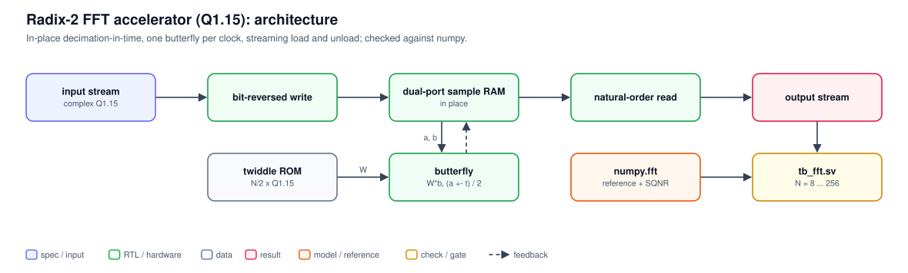
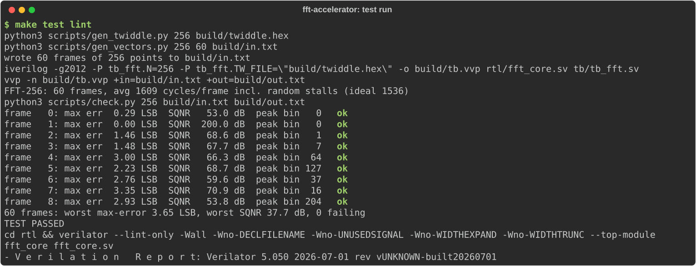

# Radix-2 FFT accelerator (Q1.15)

[](https://github.com/Ana2601/fft-accelerator/actions/workflows/ci.yml)

In-place radix-2 decimation-in-time FFT, parameterised in N, with streaming load and unload and one butterfly per clock.

## Architecture



- Complex Q1.15 samples; twiddles from `scripts/gen_twiddle.py`
- Products rounded to nearest; every butterfly output is halved (unconditional block scaling), so the result is FFT(x)/N and **cannot overflow**
- Throughput: N + (N/2)·log₂N + N cycles per transform (1,536 cycles for N = 256)
- valid/ready on both streams, `out_last` on bin N−1

## Verification

`scripts/check.py` compares every output bin with numpy's double-precision `fft(x)/N` and reports per-frame max error (LSB) and SQNR. Test frames: impulse, DC, bin-centred tones (incl. Nyquist−1), a two-tone signal with a non-bin-centred tone, a full-scale square wave, and random noise at 5 %–99 % of full scale, all with random input and output stalls.

The checker caught a real bug during development: the butterfly sum used `{{3{a[15]}}, a}`, an **unsigned** concatenation that made the whole expression unsigned. It is fixed and documented in the RTL.

## Results (measured)

| N | Frames | Worst max error | Worst SQNR | Result |
|---|---|---|---|---|
| 64 | 60 | 3.35 LSB | 43.2 dB | pass |
| 256 | 60 | 3.65 LSB | 37.7 dB | pass |
| 1024 | 20 | 4.35 LSB | 47.4 dB | pass |

Signal-bearing frames reach 53–71 dB SQNR. The 37.7 dB worst case is low-amplitude (5 % FS) broadband noise: fixed 1/N scaling pushes it down to a few LSBs. That is a property of unconditional scaling, not a defect; block-floating-point scaling would remove it.

## Run

```bash
make test            # N=256
make test N=1024 FRAMES=20
make lint
```

## Test run

Output of the CI command (`make test lint`), captured from a local run:



## Limitations / next steps

One butterfly per clock (no radix-4, no pipelined SDF architecture), no overlap between transforms, and fixed scaling (block-floating-point would recover SQNR for small inputs).

## Setup

- [OSS CAD Suite](https://github.com/YosysHQ/oss-cad-suite-build) (Icarus Verilog, Verilator, Yosys)
- Python packages: `pip install -r requirements.txt`

```bash
make test
make lint
```

The same commands run in CI on every push (`.github/workflows/ci.yml`).
